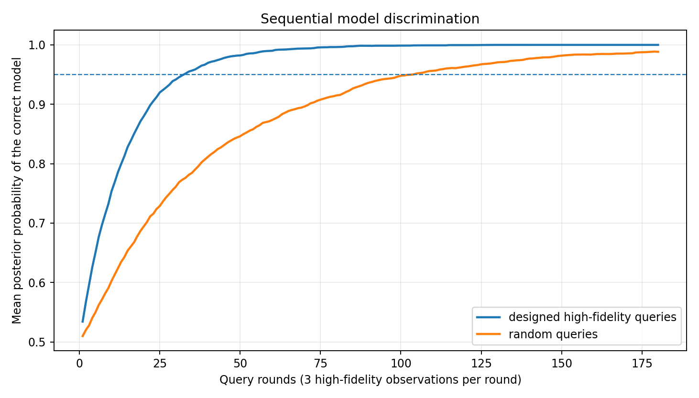
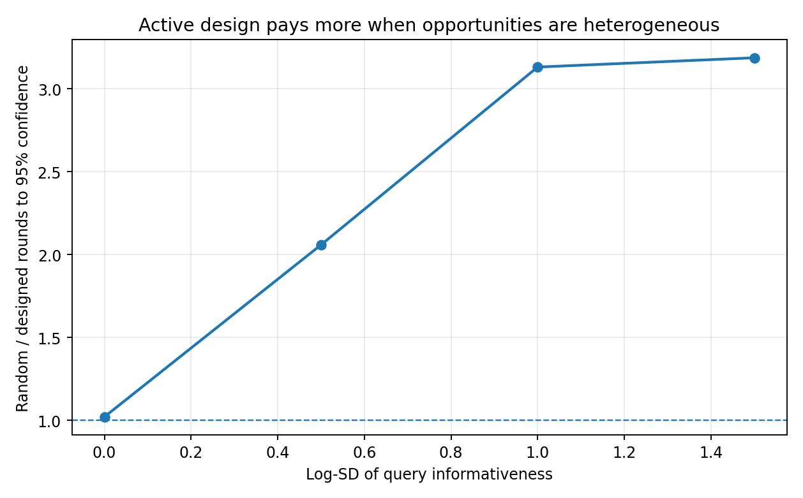
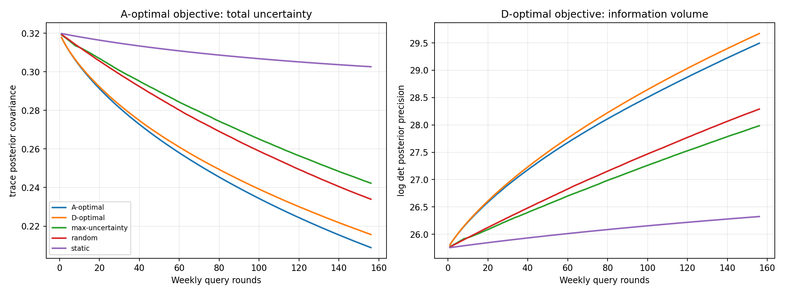
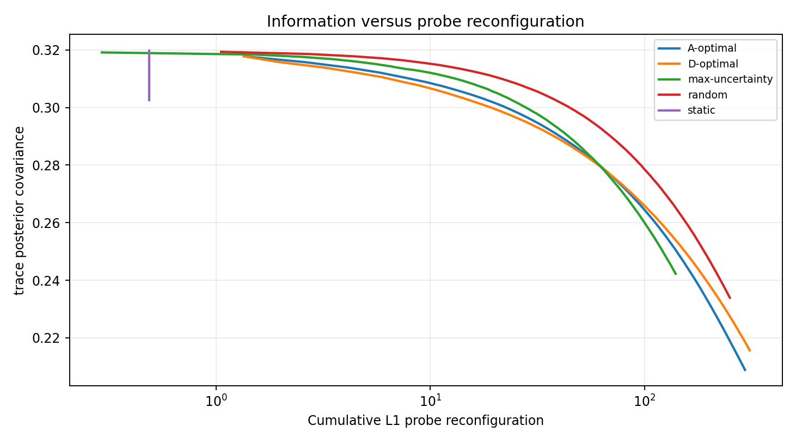
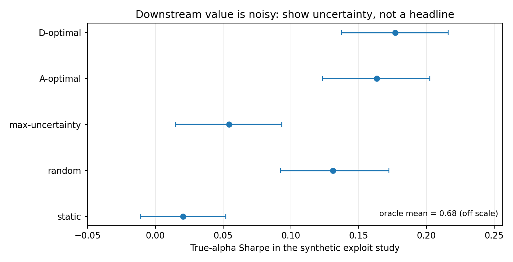

# Sequential Model Identification with MBDoE — simulated market research

[](https://github.com/AhmadEblagh205/mbdoe-asset-management/actions/workflows/ci.yml)


This repository translates ideas from my PhD in **model-based design of experiments (MBDoE)** into a synthetic financial-research setting: if measurements or research queries are limited, choose the next one for information rather than by habit.

**Scope first:** this is a simulation/methods project, not a trading strategy or investment track record. Public-market prices can be observed without holding a portfolio. The “probe portfolio” in study 1 is a linear-Gaussian **measurement vector**, used to expose the mathematics of sequential design. Study 2 is the more realistic research-allocation analogy: cheap context is visible for every candidate, but only a limited number of costly high-fidelity responses may be queried.

The code is deliberately built around a question that also matters in my doctoral work:

> **Which model should we trust, and what should we measure next?**

## Headline result: identify the rival model with about one-third of the queries

Ten synthetic candidates are governed by one of two rival response models. Each round exposes a cheap context for every candidate, but the research budget permits only **three high-fidelity observations**. The designed policy queries where the rival predictions disagree most relative to noise; the baseline queries three candidates at random.

Across **200 paired simulated worlds**, the mean designed trajectory reaches 95% posterior probability on the correct model in **33 rounds / 99 high-fidelity observations**. Random querying needs **104 rounds / 312 observations** under the same budget.

That is roughly **one-third as many observations** in this stated synthetic baseline.



The important qualification is also in the repository: the speed-up is **not universal**. It depends on there being meaningful variation in how informative candidate observations are.

## When does active design actually help?

I therefore stress-tested the result by varying the dispersion of query informativeness. When candidate observations are nearly homogeneous, designed and random querying are almost equivalent. As heterogeneity increases, the value of selecting the most informative query rises sharply.

| Log-SD of informativeness | Designed rounds to 95% | Random rounds to 95% | Random / designed |
|---:|---:|---:|---:|
| 0.0 | 193 | 197 | 1.02× |
| 0.5 | 68 | 140 | 2.06× |
| 1.0 | 38 | 119 | 3.13× |
| 1.5 | 32 | 102 | 3.19× |



That is the result I care about more than a single speed-up number: **optimal design is valuable when opportunities differ in expected information; if every query is equally informative, clever sequencing has little to buy.**

## Study 1: designed linear measurements of latent alpha

The first study isolates the Bayesian experiment-design machinery. An eight-dimensional annualised alpha vector is hidden. Each weekly round permits one scalar linear measurement

\[
z_t = w_t^\top\alpha + \eta_t,
\qquad
\eta_t\sim\mathcal N(0, 52\,w_t^\top\Sigma w_t).
\]

The posterior update is conjugate Gaussian. I compare:

- **A-optimal**: greedily minimise total posterior variance, `trace(C)`;
- **D-optimal**: greedily maximise information volume, `log det(P)`;
- **max-uncertainty heuristic**: probe the largest posterior-variance direction;
- **random probes**;
- **static direction**: repeat the same long-only measurement.

The A and D directions are solved as symmetric generalised eigenproblems. The max-uncertainty policy is explicitly labelled **E-inspired, not exact E-optimal**, because anisotropic observation noise matters.

After 156 weekly rounds, the A-optimal design reaches the random policy’s final total posterior variance after **101 rounds**; D-optimal reaches it after **112**. Repeating one static direction barely explores the parameter space because the data information added by that fixed measurement remains rank one.



The simulation also tracks cumulative L1 **probe reconfiguration**, rather than pretending this is automatically a real trading cost.



## Does better information automatically create better investment outcomes?

No — and that negative result is useful.

After 208 probe rounds, every policy forms the same mean-variance exploit direction from its posterior mean and is scored on the synthetic true alpha. With 200 paired worlds:

- A-optimal mean synthetic Sharpe: **0.163**;
- D-optimal: **0.177**;
- random: **0.131**;
- static: **0.020**;
- oracle using the latent true alpha: **0.680**.

But the paired 95% bootstrap interval for the mean improvement over random is **−0.015 to 0.082** for A-optimal and **−0.003 to 0.096** for D-optimal. Those intervals include zero.

So I do **not** claim designed probing delivers superior investment performance here. The defensible conclusion is narrower: A/D improve the posterior-information objectives they were built for, while translating those gains into downstream economic value remains noisy and uncertain at this horizon. The naive max-uncertainty heuristic is actually worse than random in the exploit study, which is a useful warning that “probe the least-known direction” can ignore the noise geometry.



## Why this project is useful

It separates three questions that are often blurred together:

1. **Parameter learning:** how should I reduce uncertainty in a latent vector?
2. **Model discrimination:** where should I measure to kill the wrong hypothesis fastest?
3. **Decision value:** do information gains actually improve the downstream decision?

The answer is not “one policy wins everything”. A-optimality wins its own objective, D-optimality wins its own objective, active discrimination can be dramatically more sample-efficient when opportunities are heterogeneous, and none of that guarantees a statistically clear downstream return advantage.

That is much closer to how I think about MBDoE in my PhD: **design criteria are choices about which uncertainty matters, not magic optimisation buttons.**

## Reproduce the reports

```bash
pip install -r requirements.txt
python src/run.py --periods 156 --reps 60 --disc-reps 200
python src/exploit.py --periods 208 --reps 200 --prior-sd 0.20
pytest -q
```

Generated artefacts:

- `reports/summary.json`
- `reports/exploit_summary.json`
- `reports/figures/alpha_learning.png`
- `reports/figures/learning_per_cost.png`
- `reports/figures/model_discrimination.png`
- `reports/figures/discrimination_sensitivity.png`
- `reports/figures/exploit_value.png`

See [`docs/METHODOLOGY.md`](docs/METHODOLOGY.md) for the equations and assumptions.

## Tests

The test suite checks the corrected closed-form Bayesian update, monotonic information growth, risk/gross constraints, A- and D-optimal one-step objectives against random candidate directions, the explicit max-uncertainty heuristic, rank-one information from a repeated static probe, active discrimination under an equal query budget, the heterogeneity sensitivity, and paired downstream uncertainty reporting. CI runs the suite on push and pull request.

## Licence

MIT — see [`LICENSE`](LICENSE).
